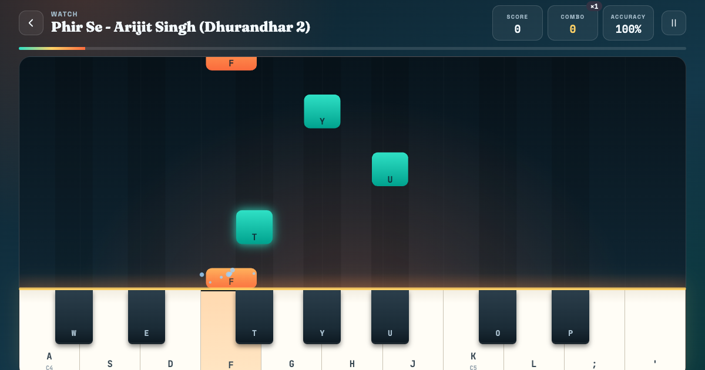

# PianoGiri

A free, browser-based falling-notes piano game. Notes rain down onto the keys: tap the short ones, hold the long ones, keep your combo alive and chase three stars. Users can also turn their own audio or MIDI into playable lessons, all inside the browser.



## Features

- **Falling-notes stage** (canvas) aligned to a keyboard that resizes to each song's range.
- **Held notes**: long tiles must be held until their tail passes the line; you score while holding, and get a bonus for finishing the hold.
- **Three modes**
  - _Practice_ waits at every note until you play it. Nothing can be missed.
  - _Perform_ keeps the beat. Each note is judged Perfect / Great / Good / Miss.
  - _Watch_ plays the song for you first.
- **Difficulty**: Easy (melody only), Medium (melody + bass), Hard (every note). Notes left out can be auto-played as backing.
- **Keyboard layouts**: _Computer keys_ fits any song into the 18-key computer layout, moving out-of-range notes by an octave. _Full piano_ keeps the original pitches (for touch screens and MIDI keyboards).
- **Speed** 50–150%, tile labels (computer keys / note names), 3-2-1 countdown, auto-pause when the tab loses focus.
- **Game loop**: score, combo with ×2–×4 multiplier, live accuracy, stars, S–D grades, personal bests, XP and levels, daily streak, 5-minute daily goal, 10 badges, and "next challenge" suggestions.
- **Inputs**: computer keyboard, mouse/multi-touch (with glissando), and USB/Bluetooth MIDI keyboards (Web MIDI; sustain pedal supported).
- **Make a lesson**: upload audio (MP3/WAV/M4A/OGG, up to 8 min), record from the mic, or import a MIDI file. Audio is converted with [Basic Pitch](https://github.com/spotify/basic-pitch-ts), the model behind [NeuralNote](https://github.com/DamRsn/NeuralNote). It runs in a Web Worker on the user's device, so no server is needed and no audio is uploaded. Lessons can be downloaded as `.mid`.
- **Free play** with a rising-notes visualiser, sustain, octave and velocity controls.

## Keyboard

| Action             | Keys                        |
| ------------------ | --------------------------- |
| White keys         | `A S D F G H J K L ; '`     |
| Black keys         | `W E T Y U O P`             |
| Octave down / up   | `Z` / `X` (free play, full piano) |
| Velocity down / up | `C` / `V`                   |
| Sustain            | `Tab`                       |
| Start / pause      | `Space` · `Esc` to pause/back · `Enter` to retry |

## Song files

Built-in songs live in `songs/` and are listed in `songs/index.json`. Two formats are accepted:

```jsonc
// Timed notes (preferred): [startSeconds, durationSeconds, midiNumber, velocity?]
{ "id": "my-song", "title": "My Song", "artist": "Someone", "difficulty": "Beginner",
  "notes": [[1.0, 0.4, 60, 90], [1.5, 1.2, 64, 80]] }

// Legacy step sequence (computer key codes, C4 = KeyA). Optional "bpm" sets spacing.
{ "id": "twinkle", "title": "Twinkle Intro", "difficulty": "Beginner", "sequence": ["KeyA", "KeyA", "KeyG"] }
```

User-made songs are stored in the browser's `localStorage` (no accounts).

## Ads (Google AdSense)

Ads are off until configured, so no empty boxes appear.

1. In AdSense → _Sites_, add the **root domain** `gauravgiri.com.np` (AdSense doesn't accept subdomains). Once it's approved, ads can run on `piano.gauravgiri.com.np` too. The review covers the root site, so it also needs real content and a privacy policy (this app's is at `/privacy.html`).
2. Put your publisher ID and two ad-unit slot IDs in `ADS` in [js/config.js](js/config.js).
3. Publish `ads.txt` on the **root domain's** site (it must end up at `https://www.gauravgiri.com.np/ads.txt` as plain text), not in this repo:
   `google.com, pub-XXXXXXXXXXXXXXXX, DIRECT, f08c47fec0942fa0`
4. In AdSense → _Privacy & messaging_, turn on the GDPR consent message (free, Google-certified CMP). No code change is needed.

Placement follows AdSense policy for games: one slot in the song library and one on the results screen. There are no ads during play or next to the keys, slots are labelled "Advertisement", and space is reserved to avoid layout shift.

## Hosting & cost

Everything runs client-side, so the site stays on **GitHub Pages (free)**:

| Piece              | Where                                | Cost |
| ------------------ | ------------------------------------ | ---- |
| Site               | GitHub Pages + custom domain (`CNAME`) | $0   |
| Piano samples      | tonejs.github.io                     | $0   |
| AI model + libs    | jsDelivr / cdnjs CDNs                | $0   |
| Audio → MIDI       | User's browser (Web Worker, WebGL)   | $0   |

### YouTube import (not enabled)

The import dialog has a disabled YouTube tab wired to `IMPORT.youtubeEndpoint` in [js/config.js](js/config.js). If you add a backend, it needs to accept `GET ?url=<youtube link>` and return audio bytes; the browser then converts the audio as usual. Cloud Run scales to zero and fits inside the free tier for light use. Before enabling it, be aware that:

- downloading YouTube audio breaks YouTube's Terms of Service;
- YouTube regularly blocks datacenter IPs (Cloud Run included);
- transcribing copyrighted songs on an ad-supported site can put an AdSense account at risk.

## Development

No build step. Serve the folder with any static server, e.g. `python3 -m http.server`, and open `http://localhost:8000`. Add `?debug` to expose `window.__pianogiri` for testing, and `?song=<id>` to deep-link a song.

## Tech

HTML, CSS, vanilla JS modules · Tone.js + Salamander piano samples · Canvas 2D · Web MIDI · Basic Pitch (TensorFlow.js) · @tonejs/midi
